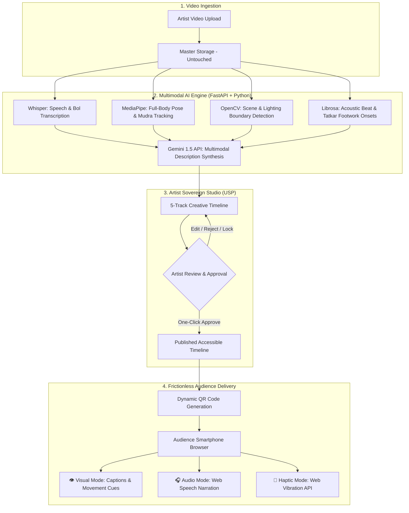

# 🎭 RASA CUE – Multimodal Performance Accessibility Platform
### *AI-Powered Accessibility with an Artist Sovereign Control Layer*

[](https://github.com/rajkshitij620-cmd/GeNarrative)
[](LICENSE)
[](frontend)
[](ai-service)
[](backend)
[](frontend/src/constants/languages.js)

> **"AI proposes. The artist approves. Everyone experiences the art."**  
> *Transforming live dance, theatre, music, and spoken word into synchronized Visual, Audio, and Haptic experiences—without ever altering the creator's original work.*

---

## ✨ What's New (Latest Updates)

| Feature | Details |
|---|---|
| 🌐 **22 Indian Official Languages + English** | Full Eighth Schedule language support with scrollable dropdown selector on all audience pages |
| 📸 **Artist Profile Photo** | Upload from gallery or capture via camera; all image formats & sizes accepted |
| 📏 **Dynamic Video-Length Timeline** | Tactile Patterns, Descriptive Narrations & Subtitle Stream timeline scales to actual video duration |
| 🔒 **Role-Based Audience Feedback** | Feedback section visible only to Audience users, hidden from Artists |
| 🎨 **Minimal Landing Page** | Focused hero messaging — clean dark design without distraction |

---

## 📌 Executive Summary & Problem Statement

Over **1.5 billion people worldwide** navigate hearing, vision, or sensory processing differences. While cinema and recorded streaming have made strides in accessibility, the **live performing arts** (classical dance, theatre, spoken word, and regional musical traditions) remain largely inaccessible:

- **Generic Subtitles Fail Art:** Dance and physical theatre are non-verbal; standard speech-to-text generates nothing when emotional gestures, mudras, and rhythms tell the story.
- **The "Creator Replacement" Fear:** Artists resist automated AI tools because generic models misinterpret traditional choreography, flatten poetic nuances, and alter cultural context.
- **High Equipment Barriers:** Traditional assistive listening or haptic vests cost thousands of dollars, making accessibility out of reach for small, independent performance troupes.

### 💡 Our Solution: RASA CUE
**RASA CUE** is a self-service, low-cost accessibility platform engineered for performing artists. An artist uploads a rehearsal or performance video, our multimodal AI pipeline analyzes the performance, and the artist reviews and approves every cue in the **Artist Sovereign Studio**. Audiences access the synchronized accessible experience directly on their personal smartphone via a simple QR code—no app downloads required.

---

## 🌟 The Core Breakthrough: The Artist Control Layer (USP)

The breakthrough of RASA CUE is **not** simply AI-generated subtitles.  
**It is the Artist Sovereign Mandate: Empowering rather than replacing creators.**

```
┌─────────────────────────────────────────────────────────────────────────┐
│                     THE ARTIST SOVEREIGN MANDATE                        │
├────────────────────────────────┬────────────────────────────────────────┤
│ What AI Proposes               │ What The Artist Controls & Decides     │
├────────────────────────────────┼────────────────────────────────────────┤
│ • Timestamps of candidate poses│ • Which movements deserve description  │
│ • Speech-to-text transcriptions│ • Which emotional moments to emphasize │
│ • Acoustic rhythm & beat onsets│ • Which beats trigger tactile vibrations│
│ • Candidate movement narration │ • Narration style: Literal vs Poetic   │
│                                │ • Lock sacred mudras from AI changes   │
└────────────────────────────────┴────────────────────────────────────────┘
```

> **Zero Original Master Mutation:**  
> The original performance video and audio master are **100% immutable**. All accessibility features exist as synchronized multi-track metadata layers rendered dynamically on the audience's device.

---

## ⚡ The 4 Sensory Modalities

| Modality | Target Audience | Technology & Experience |
|---|---|---|
| 👁️ **Visual Mode** | **Deaf & Hard-of-Hearing** | Frame-synchronized multilingual subtitles (Bengali, Hindi, English), sound event indicators (`[Ghungroo crescendo in Teentaal]`), and choreographic mudra descriptors. High contrast text designed for dimly lit auditoriums. |
| 🎧 **Audio Mode** | **Blind & Low-Vision** | Descriptive voiceover narration detailing stage lighting, dancer gaze, facial abhinaya, and hand gestures. Timed to speak dynamically in musical gaps without masking flute, sitar, or tabla. |
| 📳 **Haptic Mode** | **Sensory & Tactile Immersion** | Tactile phone vibration pulses synchronized to rhythmic footwork (*Tatkar*), percussion accents (*Tabla theka*), and emotional climaxes via the standard **Web Vibration API** (with visual pulse waves on iOS Safari). |
| 🎛️ **Artist Studio** | **Performers & Curators** | 5-track synchronized timeline editor with one-click approval, live preview simulators, cultural element locking, and instant QR code publishing. |

---

## 🎬 Proven Demonstration: 60-Second Classical Dance Showcase

To prove technical viability, RASA CUE includes an end-to-end benchmark for a **60-second Bengali & Kathak performance**:

| Output Channel | Live Demonstration Capability |
|---|---|
| **Hearing Accessibility** | Synchronized Bengali, Hindi, and English captions with sub-second accuracy. |
| **Visual Accessibility** | AI-assisted movement & mudra descriptions (*Aramandi*, *Pataka*, *Mayura*). |
| **Sensory Accessibility** | Tactile phone vibrations mapped to *Tatkar* footwork and *Teentaal* beats. |
| **Artist Sovereignty** | Granular timeline inspector to approve, edit, or reject AI proposals. |
| **Frictionless Delivery** | Scan-and-play QR experience running on consumer mobile browsers. |

---

## 🏗️ System Architecture & Multimodal Pipeline



---

## 💻 Tech Stack

### Frontend
- **Framework:** React 18, Vite, Tailwind CSS
- **Motion & UI:** Framer Motion, Lucide React, Recharts
- **Browser APIs:** Web Speech API (Audio Narration), Web Vibration API (Tactile Feedback)
- **Routing:** React Router v6

### Backend & Database
- **Runtime:** Node.js, Express.js
- **Data Persistence:** Resilient Dual-Store Architecture (MongoDB Atlas support + built-in zero-config persistent disk store `local_db.json` for seamless offline judging)
- **Security:** JWT authentication, bcryptjs password hashing, role-based access control (Artist & Audience)
- **Distribution:** Real-time dynamic QR code generation (`qrcode`)

### AI Microservice
- **Engine:** Python 3.9+, FastAPI, Uvicorn
- **Multimodal LLM:** Google Gemini 1.5 API
- **Computer Vision:** MediaPipe (pose & gesture landmarks), OpenCV (keyframe & illumination transitions)
- **Audio & Speech:** Librosa (spectral onset & percussion tracking), Whisper (multilingual speech transcription)

---

## 🚀 Quick Start Guide (One Command)

### Prerequisites
- Node.js 18+ installed
- Python 3.9+ installed

### 1. Clone the Repository
```bash
git clone https://github.com/rajkshitij620-cmd/GeNarrative.git
cd GeNarrative
```

### 2. Install Dependencies
```bash
# Install root orchestration tools
npm install

# Install backend dependencies
cd backend && npm install && cp .env.example .env && cd ..

# Install frontend dependencies
cd frontend && npm install && cp .env.example .env && cd ..

# Setup AI service virtual environment
cd ai-service
python3 -m venv venv
./venv/bin/pip install --upgrade pip
./venv/bin/pip install -r requirements.txt
cp .env.example .env
cd ..
```

### 3. Run Everything (Concurrent Launch)
From the root folder, launch the entire stack in one command:
```bash
npm run dev
```

This concurrently boots:
- 🌐 **Frontend (Vite):** `http://localhost:5173`
- ⚙️ **Backend (Express):** `http://localhost:5001`
- 🤖 **AI Engine (FastAPI):** `http://localhost:8000`

---

## 🧑‍⚖️ Hackathon Judge Walkthrough (3 Minutes)

### Demo Credentials
| Role | Email | Password |
|---|---|---|
| 🎨 Artist | `a@gmail.com` | `123456` |
| 🎧 Audience | `b@gmail.com` | `123456` |

> Click **"Fill Demo Credentials"** on the login page to auto-fill.

### Steps

1. **Open the Homepage (`http://localhost:5173`)**
   - Experience the **Interactive Multimodal Sensory Playground**: toggle Visual, Audio, and Haptic modes.
   - Click **Trigger Vibration** to feel real haptic pulses on compatible devices.

2. **Login as Artist** → `/login`
   - Open **Artist Control Studio** to view the **5-Track Creative Timeline**.
   - Inspect individual cues, switch between **Literal, Poetic, and Minimal** description styles, lock cultural mudras, and approve AI proposals.
   - Visit **Artist Profile** to upload or capture a profile photo.

3. **Experience the Live Audience Portal**
   - Click **Publish & Generate QR** or open `/experience/chhath-7872`.
   - Use the **language dropdown** (top-right) to switch between all 22 Indian official languages + English.
   - Experience the performance through **Visual Mode**, **Audio Mode**, or **Haptic Mode** in real-time.
   - Each mode shows a **dynamic timeline ruler** that scales to the exact video duration — click any marker to jump to that moment.

4. **Audience Feedback** (login as Audience `b@gmail.com`)
   - Submit anonymous accessibility ratings — only visible to Audience users.

---

## 🗺️ Project Structure

```
GeNarrative/
├── frontend/                     # React 18 + Vite frontend
│   ├── src/
│   │   ├── components/common/    # Navbar, Footer, ModeBadge, LanguageDropdown
│   │   ├── constants/            # languages.js (22 Indian official + English)
│   │   ├── context/              # AuthContext, AccessibilityContext
│   │   ├── layouts/              # ArtistLayout (Studio Sidebar)
│   │   ├── pages/                # LandingPage, Login, Register, Features, About
│   │   │   ├── artist/           # Dashboard, Upload, AIStatus, ArtistControlStudio, ArtistProfile, Analytics
│   │   │   └── audience/         # AudienceExperience, VisualMode, AudioMode, HapticMode
│   │   └── services/             # Axios API integration
├── backend/                      # Express.js REST API
│   ├── src/
│   │   ├── controllers/          # Auth, Performance, AI, Timeline, Approval, QR
│   │   ├── models/               # User, Performance, CreativeTimeline, Analytics
│   │   ├── routes/               # Modular REST endpoints
│   │   ├── services/             # Resilient Disk & Memory store (local_db.json)
│   │   └── server.js             # Server entrypoint (Port 5001)
├── ai-service/                   # FastAPI Multimodal Engine
│   ├── app/
│   │   ├── models/               # Benchmark demonstration dataset
│   │   ├── schemas/              # Pydantic analysis models
│   │   └── services/             # Gemini 1.5, MediaPipe, Librosa, Whisper
│   └── main.py                   # FastAPI entrypoint (Port 8000)
├── uploads/                      # Sample performance media & persistence db
├── package.json                  # Root runner (concurrently dev orchestration)
└── README.md                     # Comprehensive documentation
```

---

## 🎯 Alignment with Hackathon Goals

- **Empower, Don't Replace:** Unlike generative systems that replace live choreography, RASA CUE acts as an assistive co-pilot under complete human creative sovereignty.
- **Multimodal AI in the Physical World:** Bridges digital AI intelligence (computer vision, acoustic onset, LLMs) to tangible sensory real-world human experiences (tactile vibrations, audio descriptions, captions).
- **Regional & Cultural Equity:** Built specifically with Indian classical and regional performance needs at the forefront (Bengali, Hindi, mudra classifications).

---

## 📄 License

This project is licensed under the MIT License - see the [LICENSE](LICENSE) file for details.
